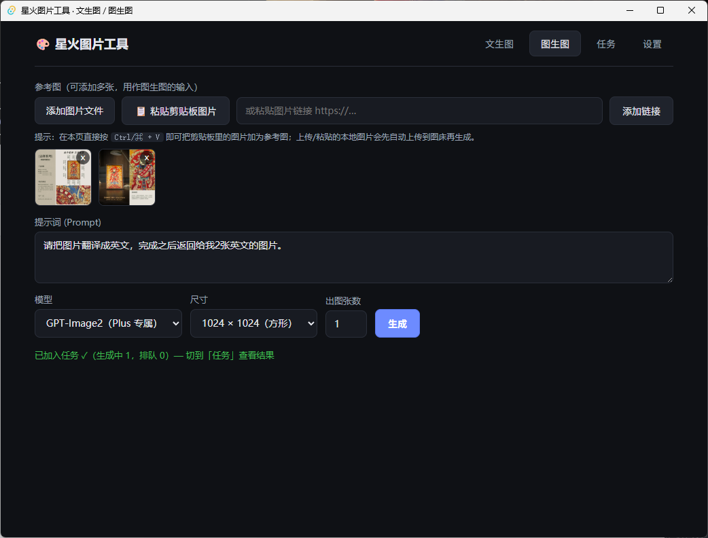
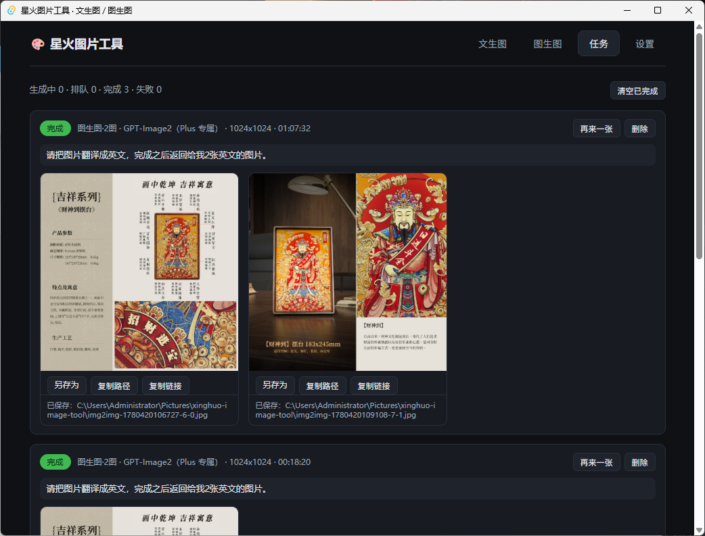

# 灵感10s (Linggan10s Image Tool)

一个基于 [Tauri 2](https://v2.tauri.app/) 的 Windows 桌面工具，调用 OpenAI 兼容的图片接口做**文生图 / 图生图**，结果自动保存到本地。

- 前端：TypeScript + Vite（无框架，纯原生 DOM）
- 后端：Rust（`reqwest` + `rustls`，所有 HTTP / 存图都在 Rust 端完成）

---

## 界面预览

**图生图：添加参考图 + 提示词，选「出图张数」后点生成**



**任务页：实时查看生成进度与结果，图片自动保存到本地**



---

## 功能

- **首页 + 独立登录页**：没凭证时先进「首页」大厅，点「登录」进登录页用网站账号登录，或直接点「我想用 API Key 使用」跳到设置页。
- **记住密码 + 自动续期**（可选，默认关）：勾上后 Token 快到期时自动换新的，启动时 / 每 30 分钟 / 生成前各检查一次。
- **两种登录方式**：`API Key`（Bearer）或 `用户名 + 密码`（换取短期 Token），可随时切换。
- **文生图**：输入提示词生成图片。
- **图生图**：添加参考图（文件 / 粘贴剪贴板 / 图片链接），按提示词改图、翻译图中文字等。
- **出图张数**：一次点击可生成 1~4 张（每张是一个独立任务，自动排队 / 并发）。
- **任务队列**：连续提交多个任务，并发数可调，实时显示「生成中 / 排队 / 完成 / 失败」。
- **自动保存**：生成的图片保存到 `图片(Pictures)/linggan10s-image-tool/`。
- **本地参考图自动上传**：本地 / 剪贴板图片会先上传到平台自带 OSS（`/api/v1/uploads/upload?public=true`）换成公网地址，供下游服务读取。
- **任务持久化**：任务列表与结果在重启后仍在（只存路径不存 base64，重新打开时从磁盘读回预览）。
- **图片放大**：点任意结果图 / 参考图可全屏放大查看。
- **🎬 漫剧工作台**（正式版默认隐藏）：内嵌一个本地工作台（分镜 / 剧本助手 / 角色库），由应用自带的 Rust 网关提供服务，无需外部依赖。详见下方说明。
- **自动更新**：启动后静默检查新版本，由用户确认后下载安装（签名校验）。详见「自动更新」一节。

---

## 使用

打开应用后先进 **首页**（没凭证时自动落在这里），两个入口：

| 入口 | 作用 |
|---|---|
| **登录** | 进独立「登录」页，填网站账号密码 → 登录后回首页，首页显示账号 / 有效期 |
| **我想用 API Key 使用** | 自动切到 API Key 模式 + 填好默认接口地址，直接跳到设置页等你粘 Key |

在 **设置** 页里「登录方式」点 **② 用户名 + 密码** 会直接跳到登录页（手上已有可用 Token 时只切模式，不用重登）。

设置页要填的项：

| 项 | 说明 |
|---|---|
| 接口地址 (Base URL) | OpenAI 兼容服务地址，例如 `https://uuerqapsftez.sealosgzg.site`（**留空自动用这个**） |
| 登录方式 | ① `API Key`：形如 `sk_xxx`，用 `Authorization: Bearer` 发送；② `用户名 + 密码`：登录换取短期 Token，用 `token` 头发送 |
| 用户名 / 密码 | 选②时填写，就是网站登录账号。**只用于换 Token，密码不保存、不外发** |
| 等待超时（秒） | 单个请求最长等待，默认 600（10 分钟），图片生成较慢，建议别调太小 |
| 最大同时任务数 | 并发数，默认 3 |
| 图片上传地址 | **留空即用平台自带 OSS（推荐）**；填了才用自定义第三方图床 |

模型：

- `gpt-5-3` — GPT-Image（标准）
- `gpt-5-4-thinking` — GPT-Image2（Plus 专属）

### 登录方式

后端同时接受两种互斥凭证（`HybridAuthControl`）：

| 方式 | 请求头 | 来源 |
|---|---|---|
| API Key | `Authorization: Bearer sk_xxx` | 网站 `/profile` → 「API Key 管理」创建 |
| 用户名 + 密码 | `token: <JWT>` | `POST {base}/api/v1/base/access_token` 换取 |

两者都不要混发：`token` 头优先级更高，客户端每次只发一种。Token 会过期，过期后重新点一次「登录」即可；生图请求发出后断线**不会**自动重发，避免重复扣费。

用「用户名 + 密码」时，密码只发给你自己填的「接口地址」，默认**不落盘**、不写日志，也不会发给第三方图床（第三方图床是匿名上传，本来就不带凭证）。

### 记住密码 & 自动续期

Token 有效期约 7 天。默认到期后手动登录一次即可；如果想让它自己续：

- 在**登录页**或**设置页**勾选 **「记住密码，到期自动续期」**，密码会以**明文**写进本机设置文件（和请求地址、API Key 存在同一个 localStorage 里）。
- 三种时机会自动续（触发条件：Token 已过期，或剩余不足 1 天）：

  | 时机 | 说明 |
  |---|---|
  | 启动时 | 打开应用就静默检查一次，续上了直接进文生图 |
  | 后台巡检 | 每 30 分钟一次，长时间挂着也不会中途掉线 |
  | 生成前兜底 | 点「生成」时发现过期，先续再继续，不打断操作 |

- 自动续期是**静默**的：成功不打扰你，失败只在登录页留一行提示（密码改过、网络断了会这样），然后等你手动登录一次。
- **取消勾选会立刻删掉已保存的密码**；点「退出登录」也会一并清掉，避免退出后还能自动登回来。
- 勾选时如果本机还没存过密码（比如你是勾之前登录的），会自动跳到登录页让你再登录一次 —— 不登录一次应用没法知道密码。
- **共用电脑或担心密码泄漏就不要勾**：不勾的话，除了到期要手动登录一次，功能完全一样。

> **手机号验证码注册的账号默认没有密码**（服务端 `password` 为 NULL），用账密登录必然失败且只会报「密码错误」。
> 登录页 / 设置页检测到用户名是手机号（或报错提到密码）时会提示去
> <https://linggan10s.shop/profile> → 「账户设置」→「设置密码」，设完再回来登录。

填好后到「文生图 / 图生图」输入提示词，选「出图张数」，点 **生成**，到「任务」页查看结果。

---

## 开发运行

需要 [Node.js](https://nodejs.org/)、[Rust](https://rustup.rs/) 工具链，Windows 上还需 WebView2 运行时（Win10/11 一般自带）。

```bash
npm install
npx tauri dev      # 启动开发模式（首次会编译 Rust，需要几分钟）
```

改前端（`src/`）会热重载；改 Rust（`src-tauri/src/`）会自动重新编译重启。

---

## 打包

```bash
# 一键打两种产物（安装版 exe + 绿色免安装 zip）
package.bat
```

或手动：

```bash
npx tauri build
```

产物位置（`src-tauri/target/release/`）：

- **安装版 exe**：`bundle/nsis/Linggan10sImageTool_<版本>_x64-setup.exe`
  双击安装，进开始菜单 / 桌面。
- **绿色免安装版**：`Linggan10sImageTool.exe`（单文件，可直接运行）
  `package.bat` 会把它压缩成 `dist-portable/Linggan10sImageTool-<版本>-portable-x64.zip`，解压即用、无需安装。

> 绿色版依赖系统的 **WebView2 运行时**（Windows 10/11 默认已装；老系统需先装一次 [WebView2 Runtime](https://developer.microsoft.com/microsoft-edge/webview2/)）。

---

## 漫剧工作台 & 内嵌网关

「漫剧工作台」是一个内嵌在应用里的本地网页工作台（分镜预览、剧本/台词助手、角色库），用来把图片接口串成漫剧分镜的生产流程。它**不依赖任何外部服务**：

- 应用启动时，Rust 端会在 `127.0.0.1` 上随机端口拉起一个 **内嵌 axum 网关**（`gateway.rs`），用 `rust-embed` 把 `web-assets/` 里的工作台页面打进二进制直接提供。
- 前端「漫剧工作台」标签页用 `<iframe>` 加载这个本地地址（`gateway_url` 命令拿到端口）。
- 网关提供这些接口：
  - `POST /api/lobster/task` — 生成一张分镜图（复用图片接口 `run_generation`），存到项目目录。
  - `POST /api/scene-image/save-local` — 把远程图片下载保存到本地项目目录。
  - `GET  /api/projects` — 列出本地项目。
- **凭据隔离**：图片的 Key / Token 通过 `configure_gateway` 命令从设置推到 Rust 端共享状态，工作台 iframe 页面本身不持有任何 Key。

> **已移除的三个上游**：聊天（`/v1/chat/completions` → sub2api）、视频生成
> （`/api/video/generate` → pic2api）和配音（`/api/dubbing/*` → DashScope）
> 的设置项与转发代码都已删除。
> `web-assets/` 里的剧本助手 / 视频 / 配音页面仍会调用这些路径，但由于工作台在
> 正式版默认隐藏（`SHOW_DRAMA = false`），这些页面不可达。若要恢复工作台并重新
> 启用这些功能，需要把对应的上游配置一起加回来。
- 工作台的项目数据 / 生成图保存在 `图片(Pictures)/linggan10s-image-tool/projects/`。

---

## 关键技术说明（踩坑记录）

- **强制 HTTP/2（rustls）**：Windows 自带的 SChannel(native-tls) 在 ALPN 协商上不稳，常降级到 HTTP/1.1，而服务端网关会在约 120s 把空闲的 HTTP/1.1 长连接掐断。改用 `rustls` 可靠协商出 HTTP/2，配合 **HTTP/2 KeepAlive PING** 心跳，长达数分钟的生成请求不再被当成空闲连接断开。
- **账号错误自动重试**：服务端轮换 ChatGPT 账号，偶尔抽到 token 被吊销的账号会快速失败（`token_revoked`），客户端遇到这类临时错误会自动重试，重新抽号。
- **每请求独立连接**：禁用空闲连接池复用，避免并发长连接触发 rustls 的 TLS 状态问题。

---

## 出图失败排查：诊断日志

线上是 Windows GUI 程序，没有控制台，`eprintln!` 在用户机器上是被丢掉的；`tauri-plugin-log` 也只在 debug 构建挂载。所以所有关键节点现在都写入本地日志文件，**不需要用户手动开 debug 模式或抓控制台**。

### 用户怎么把日志给我

设置页最下方「🩺 出图失败？导出诊断日志」：

| 操作 | 得到什么 | 适合 |
|---|---|---|
| **复制最近日志** | 环境摘要 + 最近 64 KB 日志，直接进剪贴板 | 直接粘贴到聊天里，最快 |
| **导出日志文件** | 完整日志（≤ 512 KB）写到 `图片/linggan10s-image-tool/logs/diagnostics-<时间戳>.txt`，并自动复制路径 | 发文件、留档 |
| 失败任务卡上的 **复制错误** | 该任务报错全文 + 本地时间 | 只想报一句错误时 |

导出的文件自带环境摘要（版本、系统、接口地址、登录方式、模型、超时/并发、导出时间），即使只发文件也能定位。

### 日志策略

- **循环写入、总量封顶**：`logs/app.log` + `logs/app.1.log`，各 256 KB；当前文件写满就把旧的挤到 `.1.log`，再写满覆盖最旧的一半。**任何时刻本机占用不超过 512 KB**，长期挂着也不会膨胀。
- **一行一事件**：`UTC 时间 [级别] [模块] [任务ID] event=xxx key=value ...`。同一个 `任务ID` 串起「发起 → 响应 → 每张图下载 → 成功/失败」，并发多任务也不会混。
- **关键字段**：HTTP 状态码、协议版本、各阶段耗时、响应长度、`data` 条数、图片 URL（保留 path 便于判断 403/404）、URL 是否含空格、完整 reqwest 错误链（DNS / 连接被拒 / TLS / 读超时）、非图片响应的前 200 字符。
- **隐私**：不记 API Key、Token、密码、提示词原文、图片内容、base64；URL 里 `signature/token/key/...` 等查询参数自动打码，URL authority 里的账号密码也会打码。日志脱敏在落盘前完成。

### 关于「未从响应中获取到图片：下载图片失败」

服务端生成已成功并返回图片地址后才走到下载，这一步是**幂等 GET、不会重复计费**，所以重试加在这里；而生成请求 `POST /v1/images/generations` 一次调用一次计费，代码里 `max_attempts = 1` 是刻意保留的，**任何情况下都不要给它加重试**。

下载阶段的行为：

- 单次 20s 超时（覆盖生成用的最长 11 分钟客户端超时），最多 3 次，中间 0.5s / 1.5s 退避 + 轻微抖动，整个重试预算控制在结果链接的有效期内。
- 只对连接类错误、408 / 429 / 5xx、空响应重试；**403 / 404 立刻放弃**（对象存储临时链接过期，重试只是白等）、非 `image/*` 的错误页也立刻失败，不再把 XML/HTML 当成坏掉的 png 存盘。
- 失败时把尝试次数、完整错误链和原始 URL 一起写进错误文本，用户点「复制错误」就能给到完整线索。
- 部分图片下载失败（例如 4 张里挂了 1 张）会记 `event=task_partial`，不再静默少图。

> 结果图 URL 有生命周期，用户事后手动打开报 404 属于正常现象。日志里的 `download_start` / `download_error` / `download_http_error` 时间戳能判断失败发生在窗口内还是窗口外，据此区分「当时网络问题」和「链接已失效 / 服务端清理过早」。

---

## 自动更新（Tauri Updater）

客户端用官方 `tauri-plugin-updater` 做**签名校验 + 安装**：

- 启动 6 秒后静默检查一次（网络不通只写诊断日志，不打扰用户）；设置页「🔄 版本更新」可手动检查。
- **两段式确认**：检查到新版本只把按钮变成「下载并安装 vX」，用户再点一次才真正下载 —— 因为 Windows 安装程序运行时会强制退出应用，自动安装会打断正在生成的任务。
- 安装过程显示下载进度；安装完成应用自动退出。所有检查/安装失败都会写进诊断日志（`event=update_check_failed` / `update_install_failed`），用「复制最近日志」就能排查。

### 更新源（专用域名 `update.linggan10s.com`）

配置在 `src-tauri/tauri.conf.json`：

```json
"plugins": { "updater": {
  "pubkey": "<minisign 公钥>",
  "endpoints": ["https://update.linggan10s.com/linggan10s-image-tool/latest.json"]
} }
```

> **更新域名是 `update.linggan10s.com`**，旧的 `update.linggan10s.shop` 已停用，别再引用。
> 它指向服务器上现成的静态分发目录（nginx `root /opt/hot-update-server/public`），实测
> `/vm_clone_win/manifest.json` 返回 `200 application/json`，是直出静态文件、没有 SPA 回退。
>
> 主站 `linggan10s.com` 反而是 SPA 应用，`/download/latest.json` 这类未知路径会返回
> **200 + 首页 HTML**，绝不能拿来放清单。发布后这样验收，必须是 JSON 而不是 `<!DOCTYPE html>`：
>
> ```bash
> curl -i https://update.linggan10s.com/linggan10s-image-tool/latest.json | head -20
> ```

清单格式由 CI 自动生成（`.github/workflows/build-windows.yml`）：

```json
{
  "version": "v0.1.2",
  "notes": "灵感10s v0.1.2",
  "pub_date": "2026-11-05T10:30:00Z",
  "platforms": { "windows-x86_64": {
    "signature": "<.sig 文件内容>",
    "url": "https://update.linggan10s.com/linggan10s-image-tool/XinghuoImageTool-0.1.2-x64-setup.exe"
  } }
}
```

### 签名密钥

- 已生成一对密钥，放在**项目外**、绝不提交：
  `C:\Users\Administrator\.workbuddy\keys\linggan10s-updater.key`（私钥）与 `.key.pub`（公钥）。
- 公钥已写入 `tauri.conf.json`。**私钥丢了就无法再签发更新**，请自行备份（密码管理器 / 离线 U 盘）。
- CI 需要把私钥内容配成仓库 Secret `TAURI_SIGNING_PRIVATE_KEY`（这把密钥没有密码）。
  本地用 `package.bat` 打包时设 `TAURI_SIGNING_PRIVATE_KEY_PATH` 指向私钥文件，才会生成 `.sig`。
- 未配置密钥时 CI 自动把 `createUpdaterArtifacts` 关掉（仅在构建环境里），不影响普通安装包产出；
  签名改由本机 `scripts/make-update.mjs` 完成。

### 发布一个新版

1. 三处版本号同步：`src-tauri/tauri.conf.json`、`src-tauri/Cargo.toml`、`src-tauri/Cargo.lock`。
2. 提交后打 tag 推送（如 `git tag v0.1.2 && git push origin v0.1.2`），或在 Actions 手动触发并勾 `publish`。
3. CI 产出 `XinghuoImageTool-<ver>-x64-setup.exe`、绿色版 exe / zip 并发布到 Release。
   - **配了 `TAURI_SIGNING_PRIVATE_KEY`**：CI 同时产出 `.sig` 和 `latest.json`，直接进第 4 步。
   - **没配 Secret（当前状态）**：CI 自动关掉 updater 产物，只出普通安装包。从 Release 下载
     setup.exe 后在本机执行下面这条，脚本会用私钥签名、并从 `tauri.conf.json` 读版本与 endpoint，
     生成 `.sig` 和 `latest.json`：
     ```bash
     node scripts/make-update.mjs XinghuoImageTool-0.1.2-x64-setup.exe
     ```
4. 把 **setup 安装包 + latest.json** 上传到服务器
   `/opt/hot-update-server/public/linggan10s-image-tool/`（两个文件，路径要和清单里的 `url` 一致）。
   验收：清单返回 JSON、安装包可下载、`.sig` 与清单 `signature` 一致。
5. 已安装的旧版本启动后会提示更新。

想让第 4 步全自动，在仓库 Secrets 里配 `UPDATE_SSH_HOST` / `UPDATE_SSH_USER` / `UPDATE_SSH_PORT` /
`UPDATE_SSH_PRIVATE_KEY` / `UPDATE_REMOTE_DIR`，CI 会用 scp 把安装包和清单推到网站静态目录；
不配就跳过，从 Release 下载两个文件手动放即可。

> 本机没有 Rust 工具链，`Cargo.toml` 新增的 `tauri-plugin-updater` 依赖条目会由 CI 首次构建时写进
> `Cargo.lock`；拿到 CI 生成的 lock 后记得提交回来，保持三处一致。

---

## 目录结构

```
src/                 前端（TypeScript）
  main.ts            UI：首页 / 登录页 / 文生图 / 图生图 / 任务 / 设置 / 漫剧工作台 iframe
src-tauri/           Rust 后端
  src/lib.rs         run_generation（核心生成）+ generate_images / configure_gateway /
                     gateway_url / platform_login / read_saved_image 命令；启动时拉起内嵌网关
  src/gateway.rs     内嵌 axum 网关：服务漫剧工作台静态页 + 图片生成 /api/*
  web-assets/        打进二进制的工作台页面（main.html、分镜预览、JS、角色库）
  tauri.conf.json    窗口 / 打包配置
package.bat          一键打包脚本（安装版 + 绿色版）
```
